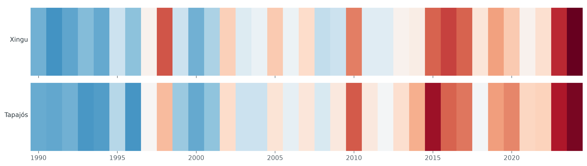
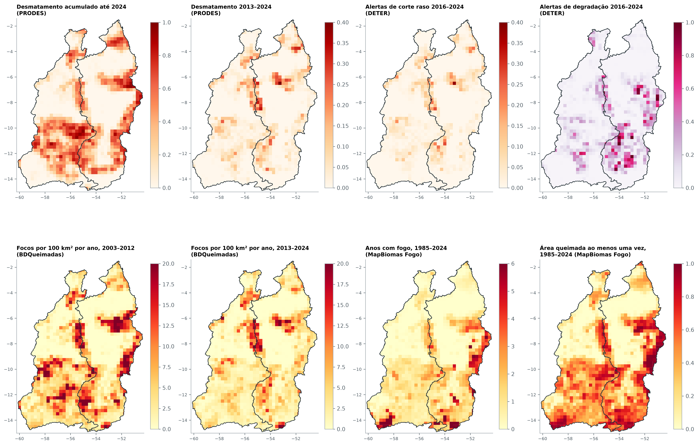
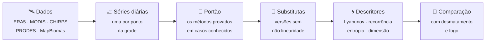

<div align="center">



# Caos na floresta–atmosfera amazônica

**A perda da floresta deixa marca na forma como o clima local evolui de um dia para o outro?<br>E as ferramentas da teoria do caos conseguem enxergar essa marca?**

[](https://thallescansi.github.io/Caos/)
[](https://github.com/ThallesCansi/Caos/actions/workflows/ci.yml)
[](pyproject.toml)
[](LICENSE)

Trabalho de Conclusão de Curso · Ilum Escola de Ciência (CNPEM) · 2026<br>
**Caio Ruas** e **Thalles Cansi**, com orientação de **Vinicius Wasques**

</div>

<sub>As faixas acima são a anomalia anual da temperatura do ar nas duas bacias estudadas, de 1990 (à esquerda) a 2024 (à direita): azul nos anos mais frios que o normal, vermelho nos mais quentes.</sub>

---

## Sobre o projeto

A Amazônia não é só um cenário onde o clima acontece: a floresta participa dele, devolvendo umidade ao ar, sombreando o solo e resfriando a superfície. Quando ela é derrubada ou queimada, é razoável esperar que o tempo local mude, não apenas na média, mas no seu **ritmo**, isto é, na maneira como um dia leva ao seguinte.

A teoria do caos oferece ferramentas feitas justamente para descrever esse ritmo: reconstruir o "espaço de estados" de uma série, medir o quanto trajetórias próximas se afastam, contar quantas vezes o sistema volta a estados parecidos. Este trabalho aplica essas ferramentas a 35 anos de clima diário em **1.541 pontos** das bacias do **Xingu** e do **Tapajós**, e compara o resultado com mapas de desmatamento e fogo.

A pergunta se divide em três partes:

| | Pergunta | Em outras palavras |
|:-:|---|---|
| 🌀 | **Natureza** | O clima diário da região é caótico, aleatório ou algo entre os dois? |
| 🌳 | **Relação** | Essa dinâmica é diferente onde a floresta foi perdida? |
| 🛰️ | **Detectabilidade** | Que tipo de dado é preciso para que essa diferença apareça? |

<div align="center">

<br><sub>Desmatamento e fogo em cada ponto da grade, segundo quatro fontes independentes (PRODES, DETER, BDQueimadas e MapBiomas).</sub>
</div>

## O que descobrimos

> [!NOTE]
> Um resumo em linguagem simples. Cada afirmação é detalhada, com figuras e testes, no caderno indicado.

1. **As ferramentas do caos precisam de cuidado.** Elas reconhecem caos em sistemas conhecidos, mas também "veem caos" em ruído que tem memória, como as estações do ano. Só alguns testes separam um caso do outro. *(cadernos 01 e 05)*
2. **O clima diário da região não é caótico no sentido clássico.** Ele se comporta como um processo aleatório com memória sazonal e uma não linearidade fraca, mas real na temperatura. *(cadernos 06 e 07)*
3. **Onde a floresta foi perdida, a temperatura diária se repete por períodos mais curtos.** A marca existe na comparação entre lugares, mas não aparece ao longo do tempo num mesmo lugar. *(caderno 08)*
4. **O tipo de dado decide o que se vê.** O satélite mede a superfície 6 a 7 °C mais quente onde a floresta virou pasto; a reanálise climática, que usa um mapa de vegetação fixo, quase não percebe a diferença. *(cadernos 08 e 09)*
5. **A floresta guarda memória do fogo.** Depois de queimada, a vegetação perde folhagem e umidade, e a diferença persiste por pelo menos três anos. *(caderno 12)*

## Como ler os cadernos

O trabalho está organizado em **13 cadernos interativos** ([Marimo](https://marimo.io)), escritos como capítulos: texto corrido, figuras explicadas e, quando faz sentido, controles para mexer nos parâmetros. Há três formas de acessá-los, da mais simples à mais completa.

| | Como | Para quem |
|:-:|---|---|
| 📖 | **[Ler na galeria](https://thallescansi.github.io/Caos/)**: cada capítulo como página web, com todas as figuras. Nada a instalar. | quem quer conhecer o trabalho |
| 🧪 | **Abrir no molab**: o botão "Abrir no molab" em cada cartão da galeria roda o caderno na nuvem (escolha o modo *Server*). | quem quer mexer nos controles e no código |
| 💻 | **Rodar localmente**: `uvx marimo edit --sandbox notebooks/00_inicio.py` instala tudo sozinho e baixa os dados processados (59 MB). | quem quer explorar a fundo |

> [!TIP]
> Comece pelo **00 · Apresentação**: ele traz a pergunta, o percurso e o resumo dos resultados, e aponta qual capítulo aprofunda cada ponto.

### Os capítulos

| | Caderno | Do que trata |
|:-:|---|---|
| **00** | [Apresentação](notebooks/00_inicio.py) | A pergunta, o percurso e o que encontramos |
| | ***Fundamentos*** | |
| **01** | [Laboratório de sistemas dinâmicos](notebooks/01_laboratorio.py) | Equilíbrios, bifurcações e caos em modelos conhecidos |
| **02** | [As bacias do Xingu e do Tapajós](notebooks/02_regioes.py) | O recorte, a grade e os pontos estudados |
| **03** | [O clima de 1990 a 2024](notebooks/03_clima.py) | Ritmo do ano, geografia e tendências |
| **04** | [Desmatamento e fogo, célula por célula](notebooks/04_perturbacao.py) | Quatro fontes e o que elas medem |
| | ***Método*** | |
| **05** | [Os métodos diante de casos conhecidos](notebooks/05_validacao_metodos.py) | O "portão": as ferramentas só entram se passarem em testes controlados |
| **06** | [Séries substitutas](notebooks/06_surrogates.py) | Como seria o clima sem não linearidade |
| **07** | [Descritores não lineares](notebooks/07_descritores.py) | 1.541 pontos, oito medidas de dinâmica |
| | ***Resultados*** | |
| **08** | [Perturbação e dinâmica](notebooks/08_gradiente.py) | O que a reanálise vê e o que o satélite vê |
| **09** | [A chuva vista de duas formas](notebooks/09_chuva.py) | Reanálise e satélite diante da perda da floresta |
| **10** | [O tempo antes do fogo](notebooks/10_fogo.py) | Quando o fogo segue o tempo seco e quando segue o calendário |
| **11** | [O território](notebooks/11_territorio.py) | Terras Indígenas e Unidades de Conservação diante do clima e do fogo |
| **12** | [A floresta como sistema dinâmico](notebooks/12_floresta_atmosfera.py) | A vegetação sozinha, com a atmosfera e depois do fogo |

## Como o trabalho foi feito



A espinha dorsal é a **reanálise ERA5**, que fornece temperatura, umidade e chuva dia a dia, sem falhas, desde 1990, numa grade de cerca de 28 km. As observações de satélite (temperatura da superfície e vegetação do MODIS, chuva do CHIRPS) servem de checagem independente.

Três cuidados atravessam todo o trabalho:

- **Nenhuma ferramenta é usada às cegas.** Antes de olhar para a Amazônia, cada medida é testada em sistemas cuja resposta já se conhece, caóticos e aleatórios.
- **Todo sinal é comparado com o acaso.** Cada série real é confrontada com centenas de "séries substitutas", que têm o mesmo ritmo sazonal e a mesma memória, mas nenhuma não linearidade.
- **As regras foram fixadas antes dos resultados.** Parâmetros e testes foram pré-registrados e congelados num commit; resultados negativos também são relatados.

> [!IMPORTANT]
> Um expoente de Lyapunov positivo **não é prova de caos**, e caos não é o mesmo que "ponto de não retorno" da floresta. O trabalho mede **associações**, e a conclusão depende sempre dos controles.

Para os detalhes do método: [docs/metodologia.md](docs/metodologia.md). Para as decisões tomadas ao longo do caminho e suas justificativas: [docs/decisoes.md](docs/decisoes.md).

## Onde está cada coisa

```text
Caos/
├── notebooks/          os 13 capítulos (cadernos Marimo)          ← comece aqui
├── src/amazon_chaos/   a biblioteca com todo o código das análises
├── docs/               metodologia, decisões, fontes de dados e guia do HPC
├── configs/            regiões, variáveis e parâmetros pré-registrados (YAML)
├── reports/            figuras e tabelas geradas pelos cadernos
├── tests/              testes automáticos dos métodos e das transformações
├── scripts/hpc/        jobs que rodaram as análises pesadas no cluster
└── data/               dados locais (fora do Git; veja docs/dados.md)
```

<details>
<summary><b>O código mais relevante, módulo por módulo</b></summary>
<br>

| Onde | O que faz |
|---|---|
| [`nonlinear/embedding.py`](src/amazon_chaos/nonlinear/embedding.py) | reconstrução do espaço de estados (atraso e dimensão) |
| [`nonlinear/lyapunov.py`](src/amazon_chaos/nonlinear/lyapunov.py) · [`estimators.py`](src/amazon_chaos/nonlinear/estimators.py) | expoente de Lyapunov (Rosenstein; Wolf e Kantz como comparação) e teste de Cao |
| [`nonlinear/recurrence.py`](src/amazon_chaos/nonlinear/recurrence.py) | análise de quantificação de recorrência (RQA) |
| [`nonlinear/ordinal.py`](src/amazon_chaos/nonlinear/ordinal.py) | entropia de permutação e complexidade ordinal |
| [`nonlinear/dimension.py`](src/amazon_chaos/nonlinear/dimension.py) | dimensão de correlação (D2) |
| [`nonlinear/surrogates.py`](src/amazon_chaos/nonlinear/surrogates.py) | séries substitutas (FT e IAAFT) |
| [`nonlinear/synthetic.py`](src/amazon_chaos/nonlinear/synthetic.py) · [`gate.py`](src/amazon_chaos/nonlinear/gate.py) | sistemas de controle e o portão dos métodos |
| [`nonlinear/ews.py`](src/amazon_chaos/nonlinear/ews.py) | sinais precoces de transição |
| [`gradient.py`](src/amazon_chaos/gradient.py) | a comparação entre perturbação e dinâmica (caderno 08) |
| [`features/`](src/amazon_chaos/features/) | desmatamento, fogo, sazonalidade e vegetação por ponto da grade |
| [`io/`](src/amazon_chaos/io/) · [`preprocess/`](src/amazon_chaos/preprocess/) | aquisição dos dados e construção das séries diárias |

</details>

<details>
<summary><b>Reproduzir o projeto</b></summary>
<br>

O ambiente é gerenciado pelo [uv](https://docs.astral.sh/uv/). Os comandos principais estão no `Makefile` (`make` sem argumentos lista todos):

```bash
make sync          # instala o ambiente exatamente como no uv.lock
make test          # roda os testes
make notebooks     # executa todos os cadernos e exporta as versões HTML
```

Os dados brutos não estão no repositório. Eles são baixados pela linha de comando do projeto (`uv run amazon-chaos --help`), sempre com manifesto e verificação de integridade, e os cálculos mais pesados rodaram num cluster. O caminho completo está em [docs/dados.md](docs/dados.md) e [docs/hpc.md](docs/hpc.md).

</details>

## Dados

ERA5 (Copernicus Climate Change Service / ECMWF) · MODIS (NASA LP DAAC) · CHIRPS (UCSB Climate Hazards Center) · PRODES, DETER e BDQueimadas (INPE) · MapBiomas · Bacias hidrográficas BHB250 (IBGE/ANA) · FUNAI e ICMBio.

## Como citar

Se este trabalho for útil para você, cite-o pelos metadados em [CITATION.cff](CITATION.cff) (o GitHub gera a referência no botão *Cite this repository*).

## Licença

O código está sob a [licença MIT](LICENSE). As bases de dados de terceiros seguem os termos das instituições responsáveis.
